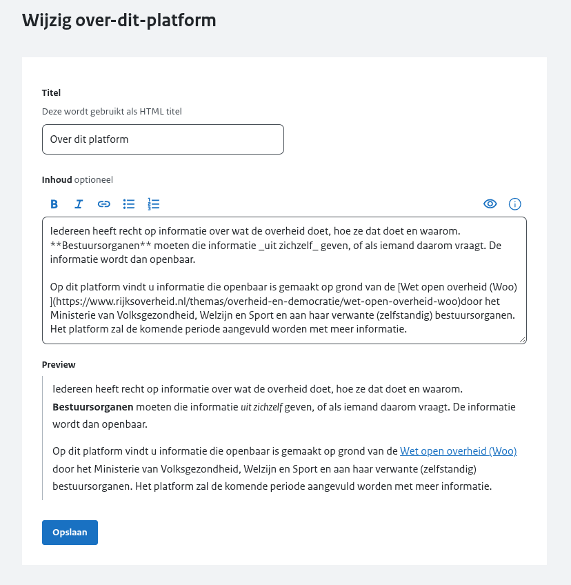

# Contentbeheer

Naast het publiceren van dossiers en documenten kun je in de Balie van het Woo Publicatieplatform ook de inhoud van een aantal pagina's op het publieke deel van het platform beheren. Het gaat om de volgende onderdelen:

- [**Onderwerpen**](./onderwerpen.md): publicaties kunnen aan een onderwerp gekoppeld worden.
Elk onderwerp heeft een eigen landingspagina waarvan je de inhoud kunt beheren.
- [**Verhaallijnen**](./verhaallijnen.md): op de landingspagina van een onderwerp kun je een verhaallijn opbouwen.
Hiermee publiceer je informatie over een onderwerp of dossier samenhangend, chronologisch of thematisch, met directe verwijzingen naar de onderliggende publicaties.
- [**Contentpagina's**](./contentpaginas.md): vaste pagina's en teksten van het platform, zoals Over dit platform, Contact, Privacy,
  Cookies, Toegankelijkheid en de teksten op de homepage.
- [**Landingspagina's van bestuursorganen**](../admin/bestuursorganen.md#wijzig-landingspagina): elk gekoppeld bestuursorgaan heeft een eigen landingspagina.
Hierop beheer je onder andere de introductietekst en het logo van het bestuursorgaan.



```{toctree}
:hidden:
:caption: Inhoudsopgave

onderwerpen
verhaallijnen
contentpaginas
../admin/bestuursorganen.md
teksteditor
```
