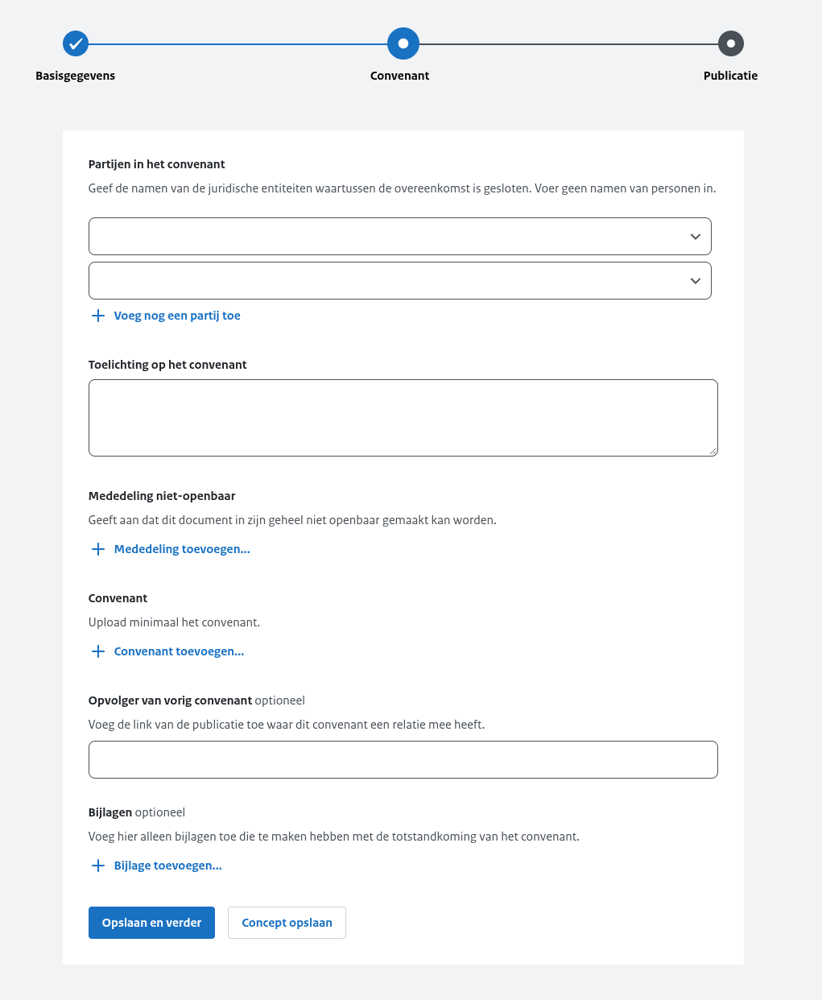

# Convenant

Kies bij ‘Nieuwe publicatie’ voor ‘**Convenant**’ en volg de [werkwijze](../index.md). Hieronder staat wat specifiek is
voor een **convenant**.

## Velden

| Stap | Veld                             | Vereist | Toelichting                                                                 |
|------|----------------------------------|---------|-----------------------------------------------------------------------------|
| 1    | Periode van het **convenant**    | Ja      | De periode waarin het **convenant** geldig is. De beginmaand is verplicht.  |
| 2    | Partijen in het **convenant**    | Ja      | Minimaal 2 partijen.                                                        |
| 2    | Toelichting op het **convenant** | Ja      | Korte toelichting op de inhoud. Wordt getoond onder de titel op de website. |
| 2    | **Convenant**                    | Ja      | Het hoofddocument, maximaal 1 bestand.                                      |
| 2    | Opvolger van vorig **convenant** | Nee     | Link naar de publicatie van het vorige **convenant**.                       |
| 2    | Bijlagen                         | Nee     | Eén of meerdere bijlagen die bij het **convenant** horen.                   |

Voor de overige velden, zie [Stap 1: Basisgegevens](../stap1-basisgegevens.md) en [Stap 2: Details en documenten](../stap2-details.md).

## Periode van het convenant

In plaats van een datum kies je in stap 1 de periode waarin het **convenant** geldig is. Je kunt een periode kiezen die begint
vanaf 10 jaar geleden tot 5 jaar in de toekomst. Het invullen van de beginmaand is verplicht.

## Partijen in het convenant

Vul minimaal twee partijen in. Je kunt kiezen uit het dropdown-menu met bestuursorganen of zelf een partij invullen.
Partijen zijn juridische entiteiten waartussen de overeenkomst is gesloten. Voer geen namen van personen in.

## Opvolger van vorig convenant

Is dit **convenant** een opvolger van een eerder **convenant**, voeg dan hier de link naar die publicatie toe.

