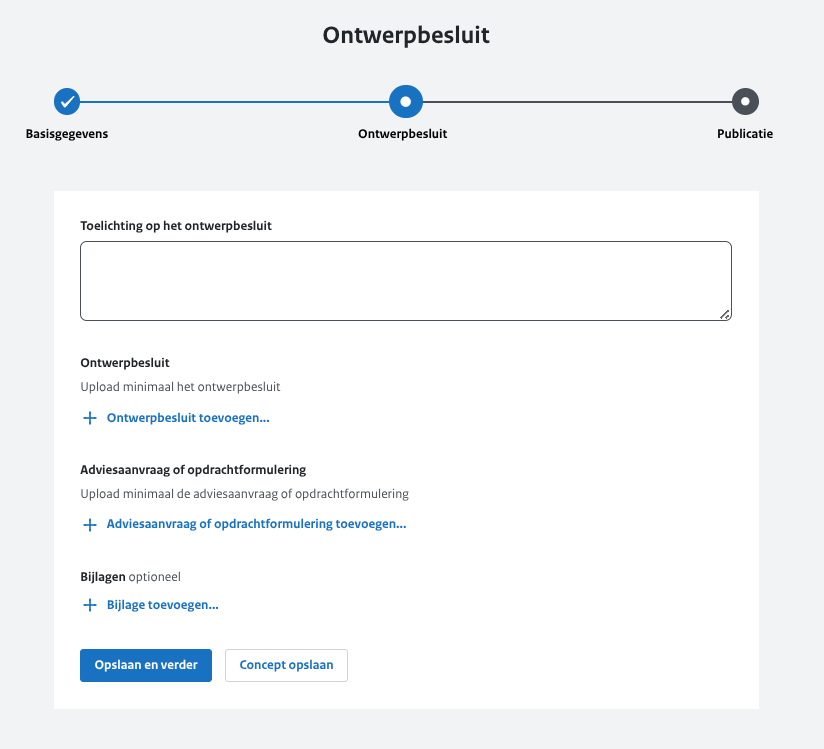
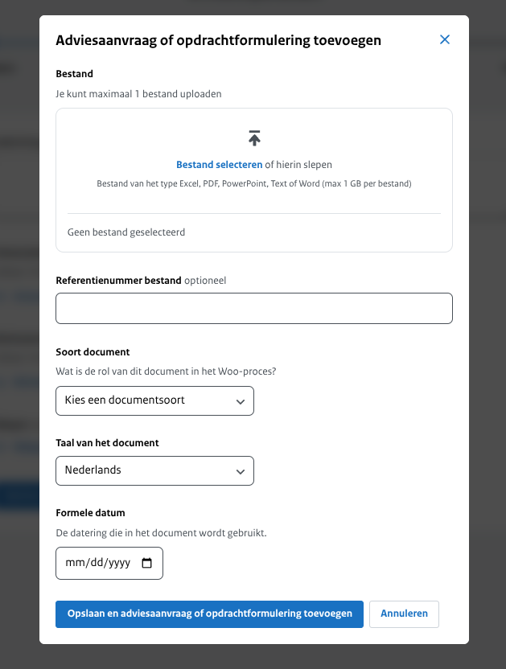

# Ontwerpbesluit

Kies bij ‘Nieuwe publicatie’ voor ‘**Ontwerpbesluit**’ en volg de [werkwijze](../index.md). Hieronder staat wat specifiek
is voor een **ontwerpbesluit**.

## Velden

| Stap | Veld                                      | Vereist | Toelichting                                                                                  |
|------|-------------------------------------------|---------|----------------------------------------------------------------------------------------------|
| 1    | Datum van het **ontwerpbesluit**          | Ja      | De datum die in het **ontwerpbesluit** wordt vermeld.                                        |
| 2    | Toelichting op het **ontwerpbesluit**     | Ja      | Korte toelichting op de inhoud. Wordt getoond onder de titel op de website.                  |
| 2    | **Ontwerpbesluit**                        | Ja      | Het hoofddocument, maximaal 1 bestand.                                                       |
| 2    | **Adviesaanvraag** of opdrachtformulering | Ja      | De aanvraag of opdrachtformulering die bij het **ontwerpbesluit** hoort, maximaal 1 bestand. |
| 2    | Bijlagen                                  | Nee     | Eén of meerdere bijlagen die bij het **ontwerpbesluit** horen.                               |

Voor de overige velden, zie [Stap 1: Basisgegevens](../stap1-basisgegevens.md) en [Stap 2: Details en documenten](../stap2-details.md).

## Adviesaanvraag of opdrachtformulering

Naast het **ontwerpbesluit** upload je verplicht de **adviesaanvraag** of opdrachtformulering die bij het **ontwerpbesluit** hoort.
Je vult hier dezelfde gegevens in als bij het [hoofddocument](../stap2-details.md#hoofddocument).

