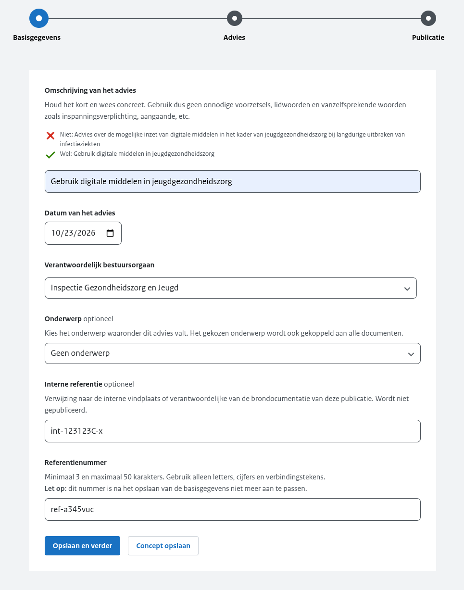

# Stap 1: Basisgegevens

In de eerste stap vul je de basisgegevens van de publicatie in. Deze velden zijn voor alle publicatietypes gelijk, op de
datum na.

## Omschrijving

In de omschrijving gebruik je geen onnodige voorzetsels, lidwoorden of vanzelfsprekende woorden, zoals de naam van het
publicatietype (bijvoorbeeld '**advies**') en 'aangaande'. Houd het kort en wees concreet. Deze omschrijving wordt als titel
op de website getoond. Dit veld is verplicht.

## Datum

Bij de meeste publicatietypes vul je hier de datum in die in het document wordt vermeld. Bij een **convenant** vul je een
periode in en bij een **jaarplan** of **jaarverslag** een jaar. Zie de pagina van het [publicatietype](publicatietypes.md).
Dit veld is verplicht.

## Verantwoordelijk bestuursorgaan

Kies uit het dropdown-menu het bestuursorgaan dat verantwoordelijk is voor deze publicatie. Is er slechts één keuze, dan is
deze optie voor je geselecteerd.

Het is alleen mogelijk om namens een bestuursorgaan te publiceren dat aan je organisatie is gekoppeld. Een bestuursorgaan
kan aan meerdere organisaties gekoppeld worden. Dit veld is verplicht.

## Onderwerp

Hier selecteer je, indien gewenst, een onderwerp uit een lijst van onderwerpen die van toepassing zijn op deze publicatie. De onderwerpen worden
aangemaakt door de organisatiebeheerder van je organisatie. Dit veld is optioneel.

Meer over onderwerpen kan je [hier](../../contentbeheer/onderwerpen.md) vinden.

## Interne referentie

De interne referentie is een vrij invulbaar veld dat niet wordt gepubliceerd. Je kunt dit veld bijvoorbeeld gebruiken ter
verwijzing naar de vindplaats van de oorspronkelijke brondocumentatie. Dit veld is optioneel.

## Referentienummer

Voer hier het referentienummer in: 3 tot 50 tekens, alleen letters, cijfers en/of verbindingstekens. Samen met de prefix
vormt het een unieke identificatie van de publicatie binnen de organisatie. Dit veld is verplicht.

:::{admonition} Let op!
:class: warning
Na het opslaan van deze stap kun je het referentienummer niet meer aanpassen, dus voer het zorgvuldig in.
:::
