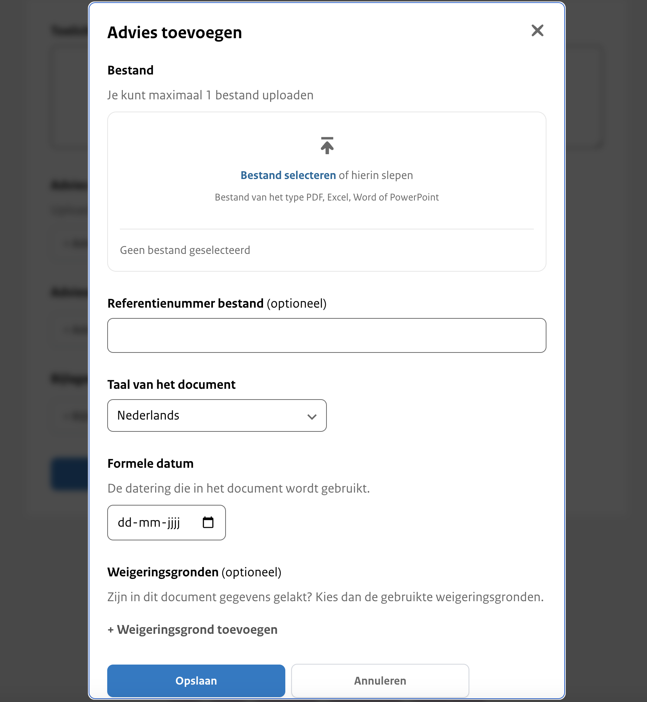
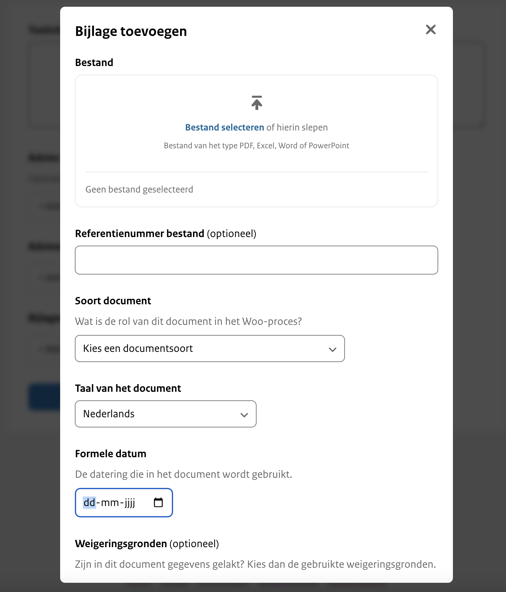

# Stap 2: Details en documenten

In de tweede stap voeg je een toelichting toe en upload je het hoofddocument en eventuele bijlagen. Sommige
publicatietypes hebben hier extra velden of een extra document. Die staan op de pagina van het [publicatietype](publicatietypes.md).

## Toelichting

Hier geef je een beknopte beschrijving van de inhoud van de publicatie. Deze toelichting verschijnt bovenaan op de website
en biedt een overzichtelijke introductie van de belangrijkste punten. Zorg ervoor dat de beschrijving helder en informatief is,
zodat lezers snel begrijpen waar de publicatie over gaat. Dit veld is verplicht.

## Hoofddocument

Upload hier het hoofddocument van de publicatie, bijvoorbeeld het **advies** of het **convenant** zelf. Dit veld is verplicht om
verder te gaan.

### Bestand

Hier upload je maximaal één bestand van het type PDF, Excel, Word of PowerPoint.

### Referentienummer bestand

Dit is een optioneel vrij invulveld. Bijvoorbeeld een verwijzing naar de interne vindplaats of verantwoordelijke van het document.
Wordt niet getoond op de website.

### Taal van het document

Keuze uit Nederlands of één van de talen uit de [waardelijst](https://standaarden.overheid.nl/tooi/waardelijsten/expression?lijst_uri=https%3A%2F%2Fidentifier.overheid.nl%2Ftooi%2Fset%2Fscw_talen%2F1)
met een selectie van officiële talen, aangevuld met Fries, Papiamentu en Papiamento.

### Formele datum

De datum die wordt gehanteerd in het document.

### Weigeringsgronden

Wanneer gegevens in het document gelakt zijn, zijn hiervoor weigeringsgronden gebruikt uit de Wet open overheid. Selecteer
indien van toepassing welke weigeringsgronden gebruikt zijn. Dit is een standaardlijst met weigeringsgronden waar je uit kunt kiezen.

## Bijlagen

Wanneer er aanvullende informatie bij de publicatie hoort die niet in het hoofddocument staat, kun je één of meerdere
bijlagen toevoegen. Bijlagen zijn optioneel. Een **klachtoordeel** heeft geen bijlagen.

Per bijlage vul je dezelfde gegevens in als bij het hoofddocument: bestand, referentienummer, taal, formele datum en
weigeringsgronden. Daarnaast kies je bij 'Soort document' uit een standaardlijst wat voor soort document de bijlage is.
