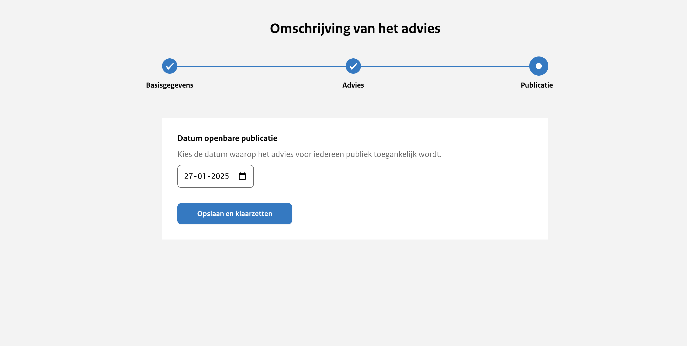

# Stap 3: Publiceren

In deze stap bepaal je vanaf welk moment de publicatie openbaar en vindbaar is op het Woo Publicatieplatform.

## Datum van publicatie

Je kunt ervoor kiezen de publicatie onmiddellijk te publiceren. De publicatie krijgt dan de status 'Openbaar'.

Je kunt de publicatie ook inplannen op een moment in de toekomst. De publicatie krijgt dan de status 'Publicatie gepland'
in de Balie en wordt op het gekozen moment automatisch 'Openbaar'.
