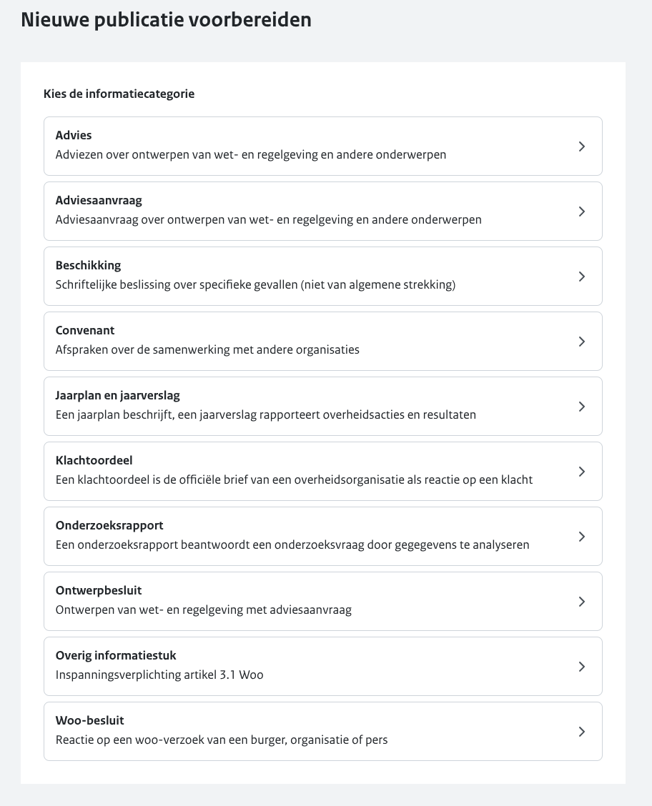

# Publicaties aanmaken

In de Balie bestaan er tien zogenoemde uploadstraten voor verschillende Woo-informatiecategorieën. De eerste stap
in het aanmaken van een nieuwe publicatie is het kiezen van de betreffende informatiecategorie waaronder de openbaar te
maken informatie valt. Zie onderstaande afbeelding.



Afhankelijk van de gekozen informatiecategorie opent de bijbehorende uploadstraat. Een **Woo-besluit** publiceer je na een
Woo-verzoek; de overige informatiecategorieën maak je actief openbaar.
In de onderstaande pagina's wordt beschreven hoe je deze uploadstraten gebruikt.

Een publicatie heeft altijd een status: **Concept** zolang je deze nog niet hebt gepubliceerd of ingepland, **Publicatie
gepland** als je in stap 3 een datum in de toekomst kiest, en **Openbaar** zodra deze op het Woo Publicatieplatform staat.
Wat je per status nog kunt aanpassen of verwijderen, lees je in [Publicaties wijzigen](../wijzigen/index.md).

Nadat een publicatie daadwerkelijk openbaar gemaakt is, wordt de metadata opgenomen in de zoekmachine van het Woo Publicatieplatform.
De publicatie en bijbehorende documenten kunnen zowel gevonden worden op basis van de metadata als op de inhoud van de documenten.

```{toctree}
:hidden:
:caption: Inhoudsopgave

woo-besluit/index
actieve-openbaarmaking/index
```
