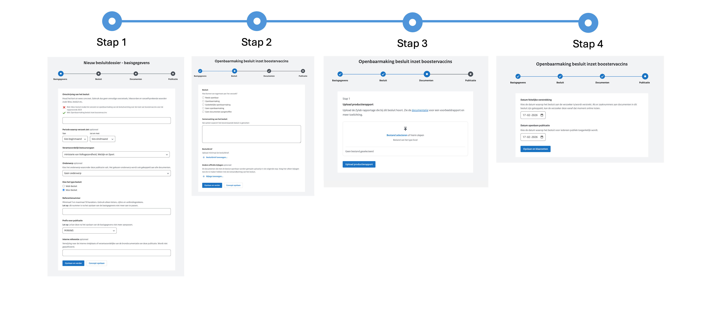

# Woo-besluit

In deze handleiding vind je alle informatie die je nodig hebt om een **Woo-besluit** te publiceren. Om te kunnen publiceren
heb je een account nodig met de rechten **publicatiebeheerder** in de Balie.

Als je inlogt in de Balie kom je terecht in het overzicht 'Alle publicaties'. Om een nieuwe publicatie aan te maken, klik
je rechtsboven op de knop **Nieuwe publicatie** en selecteer je **Woo-besluit**. Het aanmaken van een **Woo-besluit** bestaat
uit vier stappen:

1. [Basisgegevens](uploadstraat-stap1.md) invullen;
2. [Gegevens over het besluit](uploadstraat-stap2.md) toevoegen, waaronder de besluitbrief en eventuele bijlagen;
3. [Het productierapport en de bijbehorende documenten](uploadstraat-stap3.md) uploaden;
4. [De publicatiedatum](uploadstraat-stap4.md) en eventueel de datum van feitelijke verstrekking instellen.



Het grootste verschil met de uploadstraten van de andere informatiecategorieën is stap 3. De documenten die je met een
**Woo-besluit** openbaar maakt, upload je in bulk. De bijbehorende metadata leg je vast in een
[productierapport](productierapport.md).

Een **Woo-besluit** kan vier statussen hebben: Concept, Publicatie gepland, Online voor verzoekers en Openbaar. Wat je per
status nog kunt aanpassen of verwijderen, lees je in [Publicaties wijzigen](../../wijzigen/index.md).

```{toctree}
:maxdepth: 1
:caption: Inhoudsopgave

uploadstraat-stap1
uploadstraat-stap2
uploadstraat-stap3
uploadstraat-stap4
productierapport
zaken-uitgelegd
```
