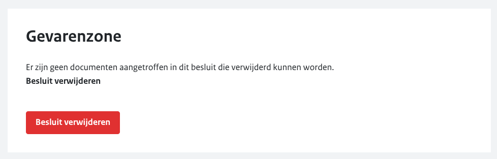
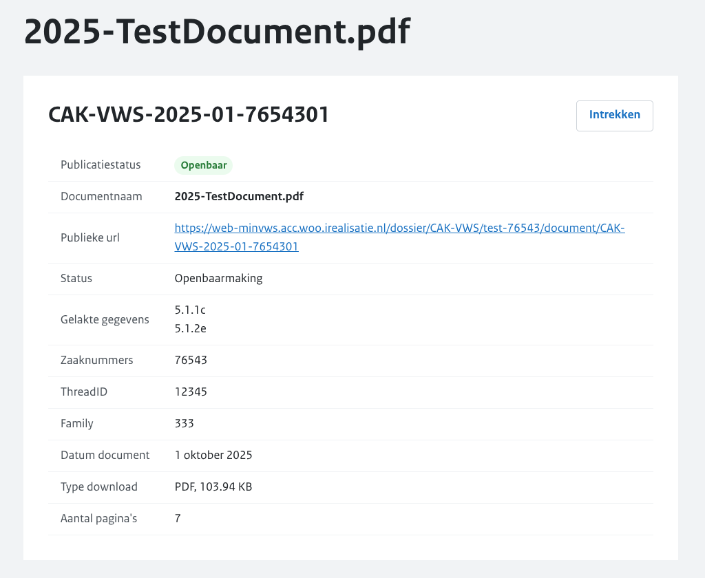
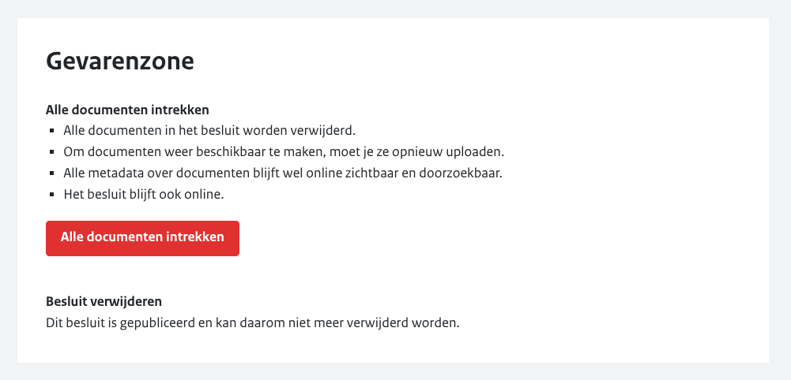
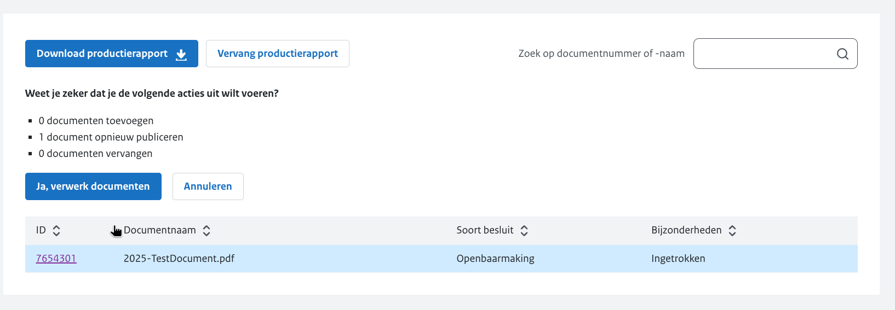

# Publicatie wijzigen

Om een Woo-besluit te wijzigen ga je naar het overzicht ‘Alle publicaties’ en klik je op de desbetreffende publicatie.
Vanuit het overzicht van de publicatie is het mogelijk om de informatie te bewerken.

## Wijzigen van publicaties in concept

Wanneer de publicatie de status 'Concept' heeft, is het nog mogelijk om alles aan te passen. Daarnaast kan je het gehele
Woo-besluit verwijderen door naar beneden te scrollen en onder het kopje ‘Gevarenzone’ op ‘Besluit verwijderen’ te klikken.

## Wijzigen na de publicatie

Zodra het Woo-besluit openbaar is gemaakt blijft het mogelijk om wijzigingen aan te brengen. Het is echter niet
meer mogelijk het Woo-besluit te verwijderen. Wel is het mogelijk om een document te vervangen door een nieuwe versie van
een document. Als je na de publicatie aanpassingen doet aan het Woo-besluit worden deze geregistreerd in de geschiedenis van
de publicatie. Deze geschiedenis is openbaar terug te vinden op de pagina van het Woo-besluit op de website.

## Intrekken van een document

Om een document in te trekken ga je naar de publicatie en klik je op de knop 'Bewerken' onder het kopje 'Documenten'. Selecteer
vervolgens het document dat je wilt intrekken. In het documentmenu vind je de optie 'intrekken'. Door hierop te klikken, wordt
het document ingetrokken en is het niet langer beschikbaar op de website. Houd er rekening mee dat intrekken alleen mogelijk is
als de publicatie al openbaar is.

## Intrekken van alle documenten uit het besluit

Het is mogelijk om alle documenten van een Woo-besluit in één keer in te trekken.
Ga hiervoor naar de publicatie en scroll naar beneden naar de 'Gevarenzone'.
Als je op de rode knop ‘Alle documenten intrekken’ drukt, dan worden alle documenten in één keer ingetrokken.

## Opschorten van documenten

Wanneer je documenten wilt opschorten kan je dit doen door het productierapport aan te passen:

1. Klik op het Woo-besluit dat je wilt aanpassen.
2. Druk op ‘bewerken’ onder het kopje documenten.
3. Klik op ‘download productierapport’ en open het Excel bestand.
4. Zoek de kolom ‘Opgeschort’ in het Excel bestand en vul daar ‘ja’ in in de rij van het document dat je wilt opschorten. Sla het bestand op.
5. Klik in de Balie op ‘Vervang productierapport’.
6. Selecteer en upload het Excel bestand.

Wanneer het productierapport is geüpload zie je onder het kopje documenten dat het document is opgeschort.

:::{admonition} Let op!
:class: warning
Het is na opschorting niet meer mogelijk dit document te openen op het Woo Publicatieplatform.
:::

De wijzigingen worden ook opgenomen in de geschiedenis van de publicatie en zijn publiek zichtbaar.

## Vervangen van documenten

### Opgeschorte documenten

Als een document is opgeschort, kan je het niet direct vervangen. Dit doe je door via het productierapport het opgeschort
label te verwijderen:

1. Klik op het Woo-besluit dat je wilt aanpassen.
2. Druk op ‘bewerken’ onder het kopje documenten.
3. Klik op ‘download productierapport’ en open het Excel bestand.
4. Zoek de kolom ‘Opgeschort’ in het Excel bestand en verwijder daar ‘ja’ in de rij van het document dat je wilt updaten. Sla het bestand op.
5. Klik in de Balie op ‘Vervang productierapport’.
6. Selecteer en upload het Excel bestand.
7. Na het uploaden van het aangepaste productierapport moet het nieuwe document worden geüpload.

Het is belangrijk dat de naam van het nieuwe document hetzelfde ID heeft als het vorige.

### Ingetrokken documenten

Als een document is ingetrokken kan je het direct vervangen:

1. Klik bij het document op 'Bestanden selecteren'.
2. Upload het gewenste document en klik op 'Bestanden verwerken'.
3. Klik op ‘Ja, verwerk documenten’ om de wijziging door te voeren.

Het is belangrijk dat de naam van het bestand hetzelfde ID heeft.

## Aanpassen metadata of toevoegen documenten

Je kunt metadata wijzigen of nieuwe documenten toevoegen door het aanpassen van een productierapport.
Om dit te doen, doorloop je de volgende stappen:

1. Klik op het Woo-besluit dat je wilt aanpassen.
2. Druk op ‘bewerken’ onder het kopje documenten.
3. Klik op ‘download productierapport’ en open het Excel bestand.
4. Breng de wijzigingen aan in het productierapport in het Excel bestand. Een voorbeeld is het wijzigen van een bestandsnaam in de kolom Document of een document toevoegen op een nieuwe rij.
5. Klik in de Balie op ‘Vervang productierapport’.
6. Selecteer en upload het Excel bestand.
7. Upload, indien gevraagd, nieuwe bestanden.

:::{admonition} Let op!
:class: warning
Het is niet mogelijk om een document, of een rij, te verwijderen uit het productierapport.
:::
