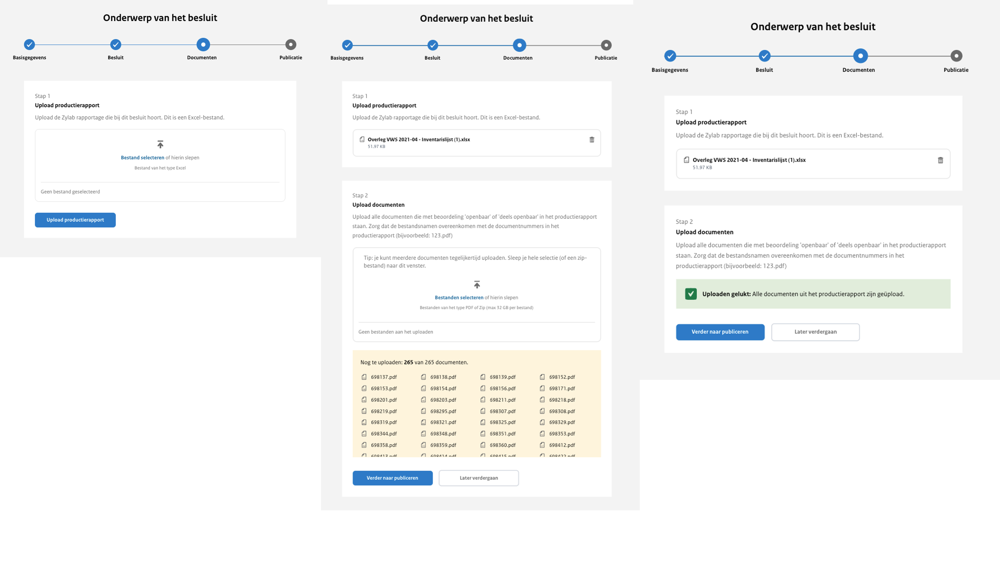

# Stap 3: Productierapport uploaden

In deze stap upload je het productierapport en daarna de documenten die je openbaar maakt.

Heb je in stap 2 gekozen voor ‘Geen openbaarmaking’ of ‘Geen documenten aangetroffen’? Dan sla je deze stap over.

## Voorbereiding

Zorg dat je het volgende klaar hebt:

- **Het productierapport:** een Excel-bestand met de metadata van alle documenten. Wat erin moet staan, lees je in
  [Productierapport uitgelegd](productierapport.md).
- **De documenten met de beoordeling openbaar of deels openbaar.** Geef elk bestand als naam het ID uit het
  productierapport. Documenten met de beoordeling **niet openbaar** of **reeds openbaar** hoef je niet te uploaden.
  Daarvoor komt wel een pagina op de website, zonder bestand.

Je kunt bestanden uploaden van het type PDF, Excel, Word, PowerPoint, tekst, audio en video. Een los bestand mag maximaal
1 GB zijn.

:::{admonition} Tip
:class: tip
Gaat het om veel documenten? Bundel ze dan in één .zip of .7z bestand van maximaal 4 GB. Dat uploadt sneller.
:::

## Stappen

1. **Upload het productierapport.** Het systeem controleert het bestand direct. Krijg je een foutmelding, pas het
   productierapport dan aan en upload het opnieuw. Veelvoorkomende oorzaken:
   - er ontbreekt een verplichte kolom;
   - de combinatie van **publicatiecontext** en ID komt al voor bij een andere publicatie.
2. **Upload de documenten.** Na het uploaden van het productierapport verschijnt een uploadvak. Sleep de documenten of het
   .zip/.7z bestand erin, of selecteer ze via je verkenner.
3. **Wacht op de verwerking.** Het systeem controleert en verwerkt de documenten op de achtergrond. Bij veel documenten kan
   dit even duren. Je kunt het scherm verlaten en later terugkomen.
4. **Controleer of alles is geüpload.** Ontbreken er nog documenten, dan kun je die later alsnog uploaden.
5. **Ga verder naar [stap 4](uploadstraat-stap4.md)** zodra alle documenten uit het productierapport zijn geüpload.

## Wat er gebeurt tijdens de verwerking

Elk document wordt gescand op virussen. Daarna wordt gecontroleerd of de bestandsnaam overeenkomt met een ID uit het
productierapport en of het bestandstype geldig is. Vervolgens wordt het document zo toegankelijk mogelijk gemaakt en wordt
de inhoud toegevoegd aan de zoekmachine.

:::{admonition} Let op!
:class: warning
Een document wordt niet opgeslagen als de bestandsnaam niet overeenkomt met een ID uit het productierapport, als het
bestandstype ongeldig is of als er mogelijk een virus in zit. Je krijgt daarvan een melding. Zo kun je nooit per ongeluk
een verkeerd of extra document publiceren.
:::
