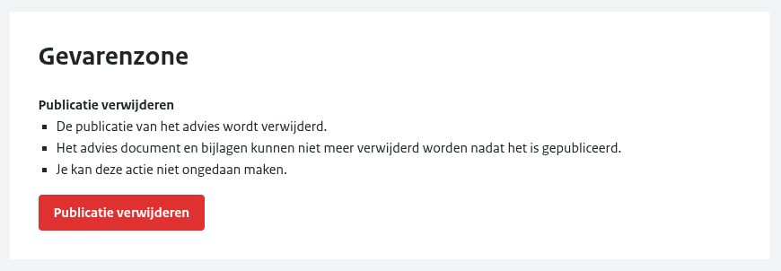
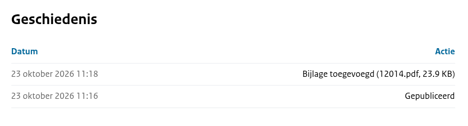
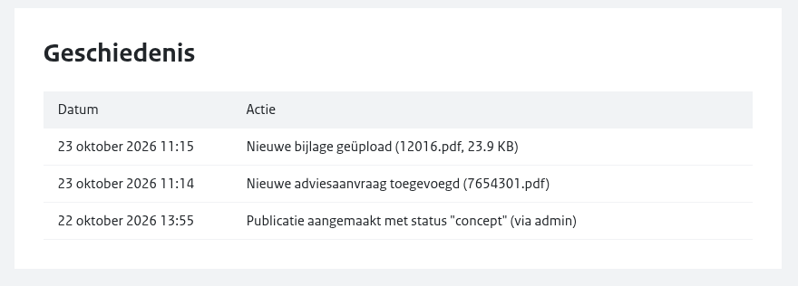
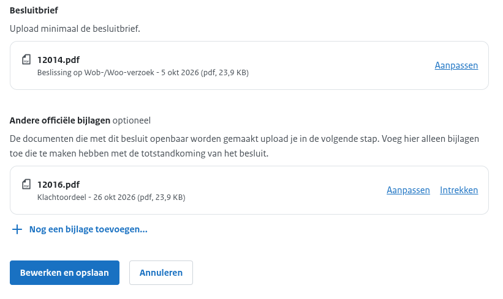

# Publicaties bewerken

## Wijzigen van publicaties in concept

Wanneer de publicatie de status **Concept** heeft, is het nog mogelijk om alles aan te passen. Daarnaast kan je de gehele
publicatie verwijderen door naar beneden te scrollen en onder het kopje ‘Gevarenzone’ op ‘Publicatie verwijderen’ te klikken.

## Wijzigen van openbare publicaties

Zodra een publicatie openbaar is, kun je deze nog steeds wijzigen. Verwijderen is dan niet meer mogelijk.
Wel kun je het hoofddocument en de bijlagen vervangen door een nieuwe versie. Wijzigingen die je na publicatie doet, worden vastgelegd in de geschiedenis van de publicatie.
Deze geschiedenis is zowel in de Balie als openbaar te zien op de pagina van de publicatie:

Geschiedenis **publieke website:**

Geschiedenis **Balie:**

## Intrekken van een bijlage

Is een publicatie gepland of openbaar, dan kun je een bijlage niet meer verwijderen, maar wel intrekken.

1. Ga naar de publicatie,
2. klik bij de gegevens en documenten (stap 2) op 'Bewerken' en klik bij de bijlage op 'Intrekken',
3. Kies een reden en geef een toelichting. Beide zijn verplicht.

De bijlage is daarna niet meer beschikbaar op de website. Op de pagina van de bijlage staat dat deze is
ingetrokken, met de datum en de reden. Het intrekken wordt ook vastgelegd in de geschiedenis van de publicatie.

- Is er een nieuwere versie van de bijlage, vervang de bijlage dan in plaats van deze in te trekken.
- Een hoofddocument kun je niet intrekken, alleen vervangen.

